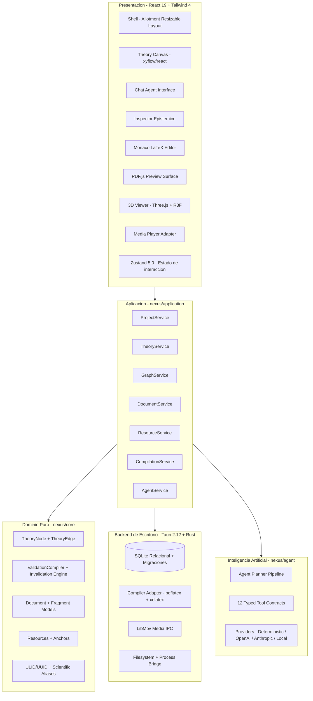

> 🇬🇧 **English** · 🇪🇸 [Español](README.md)

---

# NEXUS-232 — Unified Scientific Theoretical Workspace

[](https://react.dev/)
[](https://tauri.app/)
[](https://www.typescriptlang.org/)
[](https://tailwindcss.com/)
[-emerald.svg)](tests/)
[](LICENSE)

**NEXUS-232** is a desktop scientific workstation designed to transform intuitive exploration into formal, reproducible, and hyperlinked theoretical structures.

It integrates into a single modular environment: hypothesis deduction via directed acyclic graphs (DAGs), precise anchoring of multimodal empirical evidence, technical writing in LaTeX with native PDF compilation, three-dimensional model inspection, and assistance from logical reasoning agents guided by a **deterministic theoretical compiler**.

---

## 1. What is NEXUS-232?

In contemporary research, hypotheses emerge scattered: informal conversations, mathematical annotations in notebooks, code fragments, PDFs, and visual simulations. Connecting these pieces usually demands a manual effort that dilutes traceability and fosters logical inconsistencies.

**NEXUS-232** addresses this fracture by structuring the scientific process as a continuous cycle:

$$\text{Exploratory Conversation} \longrightarrow \text{Nodes and Deductions (Graph)} \longrightarrow \text{Anchored Evidence} \longrightarrow \text{LaTeX Fragments} \longrightarrow \text{Compiled PDF Document}$$

The application operates with the aesthetics and rigor of a **precision scientific instrument**: dark panels, subtle lines, compact monospaced typography, and a decoupled architecture where the mathematical model and persistence are independent of the user interface.

---

## 2. Disruptive Potential

### 2.1. Anti-Hallucination via Theoretical Compilation
Language models tend to fabricate mathematical steps or assume unjustified conditions to "complete" a response. In NEXUS-232, the **Fundamental Rule of the Theoretical Compiler** governs:
> When a chain of derivations reaches a contradiction, an uninstantiated dependency, incompatible empirical data, or an unjustifiable algebraic step, **the engine marks the exact point** (e.g. `H-03 ⚠` or `H-04 ⛔`).
>
> The system **never invents** a hypothesis to keep a branch alive. Invalidation cascades downward and marks all descendants for immediate re-evaluation.

### 2.2. Full Bidirectional Traceability
Every document fragment or technical equation knows which premises it originates from, and every hypothesis knows which observations support it:
* **Equation → Graph**: Clicking a LaTeX fragment in Monaco (`D-17`) illuminates in the canvas the theoretical nodes (`H-03`) that generated it.
* **Hypothesis → Multimodal Evidence**: An experiment node points to an exact video *anchor* (e.g. timestamp `13:42` in a hydrodynamic run) or to a specific page of a PDF (`p. 3`), replaying directly from that point.

### 2.3. Autonomous Agent Guided by Typed Contracts
The AI agent does not mutate the visual UI state or interact in an unstructured way. It operates through a suite of **12 typed application tools** (`create_node`, `connect_nodes`, `derive_node`, `validate_node`, `freeze_branch`, `compile_document`, etc.), ensuring that every intervention is audited in the SQLite relational database.

---

## 3. System Architecture

The project is designed as a **high-cohesion, low-coupling monorepo** managed with `pnpm` workspaces:



### Domain Isolation Principle
* `@nexus/core`: Does not import React, Tauri, Zustand, XYFlow, or AI libraries. It is pure mathematics and graph logic.
* `@nexus/desktop`: Does not access the file system directly or execute SQL; it delegates to Tauri IPC and application services.
* `@xyflow/react`: Is a visual projection of the domain graph; the only epistemological source of truth is the `TheoryGraph`.

---

## 4. How to Get the Most Out of NEXUS-232

### Flow 1: Exploration and Assisted Derivation
1. Open the **Chat** panel and write your premise in natural language (e.g. *"The perturbation of the scalar field could explain rotational anisotropy"*).
2. The agent will process the premise and execute `create_node`, instantiating node `H-01` in the **Theory Canvas**.
3. Select `H-01` and ask the agent *"Derive its observational consequences"*.
4. The agent will deduce the modified acceleration, create the derivation node `D-01`, and draw the logical implication edge.

### Flow 2: Empirical Evidence Anchoring
1. From the **Evidence & Media** tab in the lower workspace, examine the project resources (paper PDFs, datasets, simulation recordings, 3D models).
2. Create an **Anchor**:
   * **PDF**: Pin a page or coordinates of a key equation.
   * **Video**: Define a timestamp (e.g. `13:42` where turbulence begins).
   * **3D**: Capture a camera perspective over the gravitational halo.
3. Associate the resource to the node in the **Inspector**. Whenever a reviewer audits the node, a click will take them to the exact second of the video or the page of the paper.

### Flow 3: Synchronized Writing and LaTeX Compilation
1. In the **LaTeX Editor**, write your equations and sections within the standard article structure.
2. Create **Document Fragments** (`DocumentFragment`) that connect specific LaTeX lines to their corresponding nodes.
3. Press **Compile PDF** (or `Ctrl+Enter`):
   * The system detects your locally installed compiler (`pdflatex`, `xelatex`, `lualatex` or `tectonic`).
   * Runs the process in the background and captures logs and error diagnostics.
   * Automatically opens the resulting document in the **PDF Preview** tab.

### Flow 4: Consistency Control and Branch Freezing
1. If an empirical parameter refutes an intermediate step, mark the node as `BLOCKED` or `INVALID`.
2. The propagation engine will traverse the consequence chain and automatically invalidate derived theorems.
3. If you have validated a fundamental theoretical branch that should not suffer accidental modifications, use the **Freeze Branch** function (`freezeBranch`). The branch will be locked against speculative mutations.

### Flow 5: Connecting Your Own AI Models
The system includes the `DeterministicScientificProvider` by default to operate 100% autonomously and offline without requiring API keys.
To activate advanced commercial or local models:
* **OpenAI**: Configure your API Key in settings to enable `gpt-4o` with structured function calling.
* **Anthropic**: Select Claude 3.5 Sonnet for analytical reasoning of extensive scientific texts.
* **Local Models**: Point to Ollama, llama.cpp, or vLLM endpoints (`http://localhost:11434`) for confidential research or network-isolated environments.

---

## 5. Getting Started

### System Requirements
* **Node.js**: v20 or later (v24 recommended).
* **pnpm**: v10 or later (v12 compatible).
* **LaTeX Compiler** (optional, for native PDF compilation): MiKTeX or TeX Live with `pdflatex` on the system PATH.
* **Rust & Cargo**: v1.80+ (to compile the native desktop application with Tauri).

### Installation
```powershell
# Clone the repository
git clone https://github.com/deviceargent/NEXUS-232.git
cd NEXUS-232

# Install monorepo dependencies
pnpm install
```

### Run in Development
To start the interactive interface with fast HMR reload:
```powershell
pnpm dev
```
Access `http://localhost:1420` in your browser or launch the Tauri shell:
```powershell
pnpm --filter @nexus/desktop tauri dev
```

### Run Automated Tests
To run the full unit test suite and the vertical-slice integration test:
```powershell
pnpm test
```

### Build for Production
```powershell
pnpm build
```

---

## 6. Roadmap

- [x] Complete modular architecture across 5 decoupled packages.
- [x] Epistemic validation engine and fundamental anti-hallucination rule.
- [x] Interactive XYFlow canvas with 9 node types and status badges.
- [x] Monaco LaTeX editor, fragment synchronization, and integrated PDF viewer.
- [x] Media adapter with timestamp anchors and 3D model support via Three.js.
- [x] SQLite relational persistence layer and IPC commands in Rust/Tauri.
- [x] Full end-to-end vertical-slice integration test verified.
- [ ] Export theoretical graphs in GraphML, JSON-LD, and bibLaTeX formats.
- [ ] Integration with symbolic algebra solvers (SymPy / Maxima).
- [ ] Tensor visualization and N-body density maps in WebGPU.

---

## 7. License

This project is distributed under the **MIT** license. See the [LICENSE](LICENSE) file for details.
