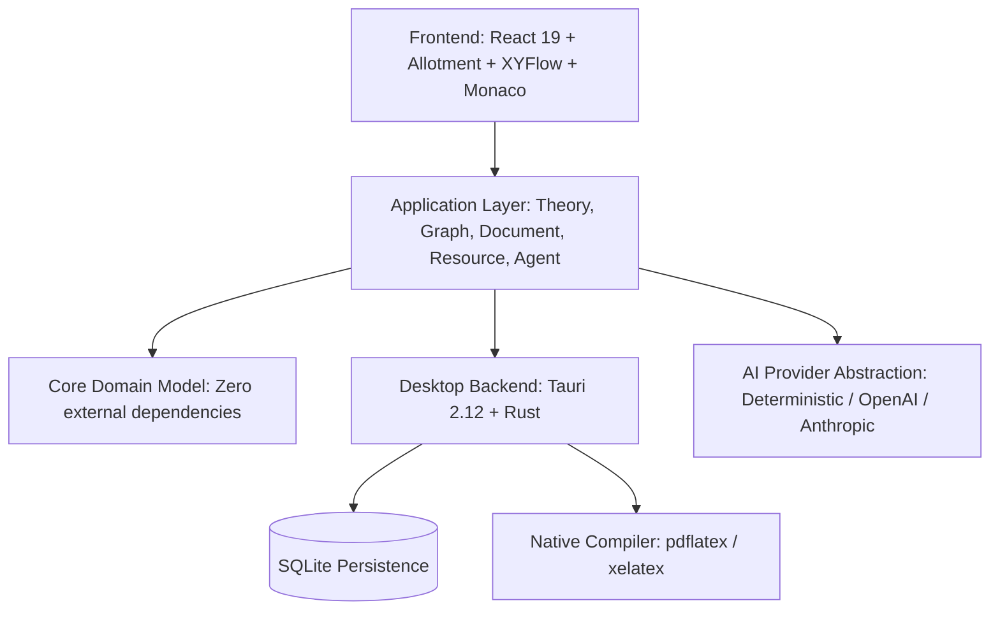

# NEXUS-232 — Scientific Theoretical Workspace

[](https://react.dev/)
[](https://tauri.app/)
[](https://www.typescriptlang.org/)
[](https://tailwindcss.com/)
[-emerald.svg)](tests/)
[](LICENSE)

**NEXUS-232** is a modular scientific desktop workspace designed for exploring hypotheses, representing theoretical derivations as a directed acyclic graph, anchoring empirical evidence and resources, drafting LaTeX papers, compiling real PDFs, and inspecting 3D model simulations.

Built with the aesthetic and tactile precision of a high-end scientific instrument.

---

## 1. System Architecture



### The Desktop Interface

```
┌─────────────────────────────────────────────────────────────────┐
│ TOP BAR: NEXUS-232 | Ideas | Evidencia | Teoría | Search        │
├──────────┬──────────────────────┬──────────────────┬────────────┤
│ SIDEBAR  │ CHAT                 │ THEORY CANVAS    │ INSPECTOR  │
│          │                      │                  │            │
│ Inicio   │ Conversación con     │ Zoom / Pan       │ Nodo       │
│ Chat     │ agente científico    │ 9 tipos de nodos │ Recursos   │
│ Árbol    │ Herramientas tipadas │ MiniMap          │ Relaciones │
│ Docs     │ Streaming            │ Status badges    │ Historial  │
│ Medios   │ Píldoras interactivas│ Conexiones       │ Freeze     │
├──────────┴──────────────────────┴──────────────────┴────────────┤
│ LOWER WORKSPACE: LaTeX Editor | PDF Preview | Evidencia | 3D    │
├─────────────────────────────────────────────────────────────────┤
│ STATUS BAR: Workspace Activo • Nodos • Aristas • pdflatex READY │
└─────────────────────────────────────────────────────────────────┘
```

---

## 2. Core Scientific Tenets

### The Fundamental Rule of the Theoretical Compiler
When a derivation chain reaches:
* Contradiction
* Missing prerequisite or uninstantiated dependency
* Incompatible empirical observation
* Unknown boundary condition
* Unjustifiable mathematical step

The compiler flags the **exact point** (e.g. `H-03 ⚠` or `H-04 ⛔`).
* The engine **never** invents an unjustified assumption to force branch continuity.
* Status changes cascade downwards along consequence paths.
* When a node is modified, all consequences are marked for re-evaluation.
* Branches can be locked against speculative mutation via `freezeBranch()`.

---

## 3. Monorepo Organization

```
NEXUS-232/
├── apps/
│   └── desktop/               # React 19 + Tauri 2.12 desktop application
│       ├── src/               # Canvas, Chat, Inspector, Monaco LaTeX, PDF.js, 3D
│       └── src-tauri/         # Rust backend, SQLite layer, compiler adapter
│
├── packages/
│   ├── core/                  # Pure TypeScript domain models (zero dependencies)
│   ├── application/           # Domain orchestration services & persistence
│   ├── agent/                 # Provider abstraction, planner, and 12 typed tools
│   └── ui/                    # Design tokens (--nexus-*), themes, UI primitives
│
├── tests/
│   ├── unit/                  # Graph consistency, validation rules, tools
│   └── integration/           # Complete vertical slice test suite
│
└── docs/
    ├── architecture.md        # Technical architecture & decoupling constraints
    ├── domain-model.md        # Entities, epistemic statuses & anchors
    ├── ui-system.md           # Tokens, density, Allotment resizable layouts
    └── agent-contract.md      # Tool definitions and AI provider abstraction
```

---

## 4. Getting Started

### Prerequisites
* **Node.js**: v20+ (recommended v24)
* **pnpm**: v10+ (v12 supported)
* **LaTeX** (optional for native PDF compilation): `pdflatex` (MiKTeX or TeX Live)
* **Rust**: 1.80+ (for building native Tauri desktop binaries)

### Installation
Clone the repository and install workspace dependencies:
```bash
git clone https://github.com/deviceargent/NEXUS-232.git
cd NEXUS-232
pnpm install
```

### Development Mode
Launch the interactive scientific workspace:
```bash
pnpm dev
```
Open your browser at `http://localhost:1420` or run inside the Tauri shell.

### Running Test Suites
Run the unit and integration tests (including the complete end-to-end vertical slice):
```bash
pnpm test
```

### Production Build
Build all packages and bundle the desktop application:
```bash
pnpm build
```

---

## 5. Documentation

For deep technical specifications, refer to the documentation in [`docs/`](docs/):
* [Architecture Guide](docs/architecture.md)
* [Domain Model & Epistemology](docs/domain-model.md)
* [UI & Design System](docs/ui-system.md)
* [Agent Tool Contracts](docs/agent-contract.md)

---

## 6. License

This project is licensed under the [MIT License](LICENSE).
