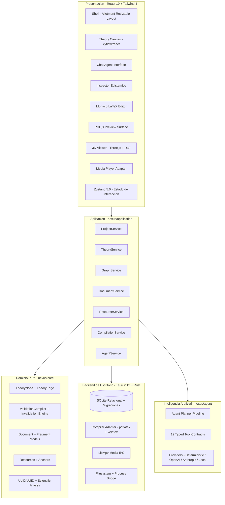

# NEXUS-232 — Unified Scientific Theoretical Workspace

[](https://react.dev/)
[](https://tauri.app/)
[](https://www.typescriptlang.org/)
[](https://tailwindcss.com/)
[-emerald.svg)](tests/)
[](LICENSE)

**NEXUS-232** es una estación de trabajo científica de escritorio diseñada para convertir la exploración intuitiva en estructuras teóricas formales, reproducibles e hipervinculadas. 

Integra en un único entorno modular la deducción de hipótesis mediante grafos dirigidos acíclicos (DAGs), el anclaje preciso de evidencia empírica multimodal, la redacción técnica en LaTeX con compilación nativa a PDF, la inspección tridimensional de modelos y la asistencia de agentes de razonamiento lógico guiados por un **compilador teórico determinista**.

---

## 1. ¿Qué es NEXUS-232?

En la investigación contemporánea, las hipótesis nacen dispersas: conversaciones informales, anotaciones matemáticas en cuadernos, fragmentos de código, papers en PDF y simulaciones visuales. Unir estas piezas suele demandar un esfuerzo manual que diluye la trazabilidad y fomenta inconsistencias lógicas.

**NEXUS-232** aborda esta fractura estructurando el proceso científico como un ciclo continuo:

$$\text{Conversación Exploratoria} \longrightarrow \text{Nodos y Deducciones (Grafo)} \longrightarrow \text{Evidencia Anclada} \longrightarrow \text{Fragmentos LaTeX} \longrightarrow \text{Documento PDF Compilado}$$

La aplicación opera bajo la estética y el rigor de un **instrumento científico de precisión**: paneles oscuros, líneas sutiles, tipografía monoespaciada compacta y una arquitectura desacoplada donde el modelo matemático y la persistencia son independientes de la interfaz de usuario.

---

## 2. El Potencial Disruptivo

### 2.1. Anti-Alucinación mediante Compilación Teórica
Los modelos de lenguaje tienden a fabricar pasos matemáticos o a suponer condiciones no justificadas para "completar" una respuesta. En NEXUS-232 rige la **Regla Fundamental del Compilador Teórico**:
> Cuando una cadena de derivaciones alcanza una contradicción, una dependencia no instanciada, un dato empírico incompatible o un paso algebraico no justificable, **el motor marca el punto exacto** (e.g. `H-03 ⚠` o `H-04 ⛔`).
> 
> El sistema **jamás inventa** una hipótesis para mantener viva la rama. La invalidación desciende en cascada y marca a todos los descendientes para reevaluación inmediata.

### 2.2. Trazabilidad Bidireccional Total
Cada fragmento de un documento o ecuación técnica sabe de qué premisas proviene, y cada hipótesis conoce qué observaciones la sustentan:
* **Ecuación $\to$ Grafo**: Al hacer clic en un fragmento de LaTeX en Monaco (`D-17`), el sistema ilumina en el canvas los nodos teóricos (`H-03`) que la originaron.
* **Hipótesis $\to$ Evidencia Multimodal**: Un nodo de experimento apunta a un *anchor* exacto de video (e.g. timestamp `13:42` en una corrida hidrodinámica) o a una página puntual de un PDF (`pág. 3`), reproduciéndose directamente desde ese punto.

### 2.3. Agente Autónomo Guiado por Contratos Tipados
El agente de IA no muta el estado visual de la UI ni interactúa de forma desestructurada. Opera mediante una suite de **12 herramientas tipadas de aplicación** (`create_node`, `connect_nodes`, `derive_node`, `validate_node`, `freeze_branch`, `compile_document`, etc.), garantizando que cada intervención quede auditada en la base de datos relacional SQLite.

---

## 3. Arquitectura del Sistema

El proyecto está diseñado como un **monorepo de alta cohesión y bajo acoplamiento** administrado con workspaces de `pnpm`:



### Principio de Aislamiento de Dominio
* `@nexus/core`: No importa React, Tauri, Zustand, XYFlow ni librerías de IA. Es matemática pura y lógica de grafos.
* `@nexus/desktop`: No accede directamente al sistema de archivos ni ejecuta SQL; delega en Tauri IPC y en los servicios de aplicación.
* `@xyflow/react`: Es una proyección visual del grafo de dominio; la única fuente de verdad epistemológica es el `TheoryGraph`.

---

## 4. Cómo Aprovechar al Máximo NEXUS-232

### Flujo 1: Exploración y Derivación Asistida
1. Abra el panel de **Chat** y redacte su planteamiento en lenguaje natural (ej. *"La perturbación del campo escalar podría explicar la anisotropía rotacional"*).
2. El agente procesará la premisa y ejecutará `create_node`, instanciando el nodo `H-01` en el **Theory Canvas**.
3. Seleccione `H-01` y solicite al agente *"Derivá sus consecuencias observacionales"*.
4. El agente deducirá la aceleración modificada, creará el nodo de derivación `D-01` y trazará la arista de implicación lógica.

### Flujo 2: Anclaje de Evidencia Empírica y Anchors
1. Desde la pestaña **Evidencia & Media** del espacio inferior, examine los recursos del proyecto (PDFs de papers, datasets, grabaciones de simulaciones, modelos 3D).
2. Cree un **Anchor**:
   * **PDF**: Fije una página o coordenadas de una ecuación clave.
   * **Video**: Defina un timestamp (ej. `13:42` donde inicia la turbulencia).
   * **3D**: Capture una perspectiva de cámara sobre el halo gravitatorio.
3. Asocie el recurso al nodo en el **Inspector**. Cada vez que un revisor audite el nodo, un clic lo llevará al segundo exacto del video o a la página del paper.

### Flujo 3: Redacción Sincronizada y Compilación LaTeX
1. En el **LaTeX Editor**, redacte sus ecuaciones y secciones dentro de la estructura estándar del artículo.
2. Cree **Fragmentos de Documento** (`DocumentFragment`) que conecten líneas específicas de LaTeX con los nodos correspondientes.
3. Presione **Compilar PDF** (o `Ctrl+Enter`):
   * El sistema detecta su compilador local instalado (`pdflatex`, `xelatex`, `lualatex` o `tectonic`).
   * Ejecuta el proceso en segundo plano y captura los registros y diagnósticos de error.
   * Abre automáticamente el documento resultante en la pestaña **PDF Preview**.

### Flujo 4: Control de Consistencia y Congelamiento de Ramas
1. Si un parámetro empírico refuta un paso intermedio, marque el nodo como `BLOCKED` o `INVALID`.
2. El motor de propagación recorrerá la cadena de consecuencias e invalidará automáticamente los teoremas derivados.
3. Si ha validado una rama teórica fundamental que no debe sufrir modificaciones accidentales, utilice la función **Congelar Rama** (`freezeBranch`). La rama quedará bloqueada frente a mutaciones especulativas.

### Flujo 5: Conexión con Modelos de IA Propios
El sistema incluye por defecto el `DeterministicScientificProvider` para funcionar de manera 100% autónoma y offline sin requerir claves de API.
Para activar modelos avanzados comerciales o locales:
* **OpenAI**: Configure su API Key en los ajustes para habilitar `gpt-4o` con function calling estructurado.
* **Anthropic**: Seleccione Claude 3.5 Sonnet para razonamiento analítico de textos científicos extensos.
* **Modelos Locales**: Apunte a endpoints de Ollama, llama.cpp o vLLM (`http://localhost:11434`) para investigación confidencial o con aislamiento de red.

---

## 5. Puesta en Marcha

### Requisitos del Sistema
* **Node.js**: v20 o superior (recomendado v24).
* **pnpm**: v10 o superior (v12 compatible).
* **Compilador LaTeX** (opcional, para compilar PDFs nativos): MiKTeX o TeX Live con `pdflatex` en el PATH del sistema.
* **Rust & Cargo**: v1.80+ (para compilar la aplicación nativa de escritorio con Tauri).

### Instalación
```powershell
# Clonar el repositorio
git clone https://github.com/deviceargent/NEXUS-232.git
cd NEXUS-232

# Instalar dependencias del monorepo
pnpm install
```

### Ejecutar en Desarrollo
Para iniciar la interfaz interactiva con recarga rápida (HMR):
```powershell
pnpm dev
```
Acceda a `http://localhost:1420` en su navegador o inicie el shell de Tauri:
```powershell
pnpm --filter @nexus/desktop tauri dev
```

### Ejecutar Pruebas Automatizadas
Para correr el conjunto de tests unitarios y la prueba de integración de vertical slice completo:
```powershell
pnpm test
```

### Compilar para Producción
```powershell
pnpm build
```

---

## 6. Hoja de Ruta (Roadmap)

- [x] Arquitectura modular completa en 5 paquetes desacoplados.
- [x] Motor de validación epistémica y regla fundamental anti-alucinaciones.
- [x] Canvas interactivo XYFlow con 9 tipos de nodos y badges de estado.
- [x] Editor Monaco LaTeX, sincronización con fragmentos y visor PDF integrado.
- [x] Adaptador de medios con *timestamp anchors* y soporte de modelos 3D con Three.js.
- [x] Capa de persistencia relacional SQLite y comandos IPC en Rust/Tauri.
- [x] Test de integración de corte vertical completo end-to-end verificado.
- [ ] Exportación de grafos teóricos en formato GraphML, JSON-LD y bibLaTeX.
- [ ] Integración con solvers simbólicos de álgebra computacional (SymPy / Maxima).
- [ ] Soporte para visualización de tensores y mapas de densidad N-body en WebGPU.

---

## 7. Licencia

Este proyecto se distribuye bajo la licencia **MIT**. Consulte el archivo [LICENSE](LICENSE) para más detalles.
